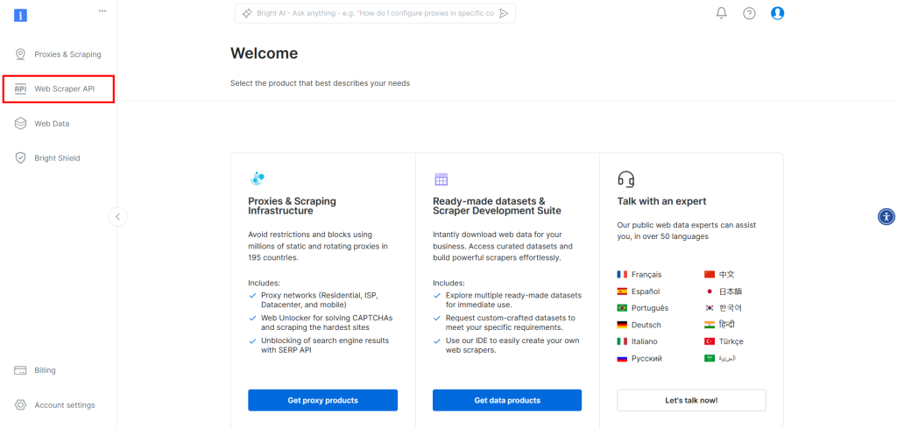
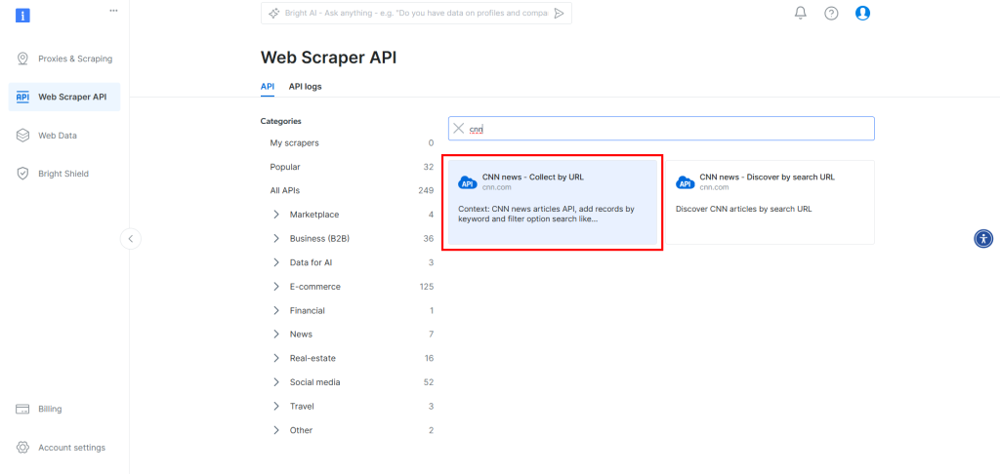
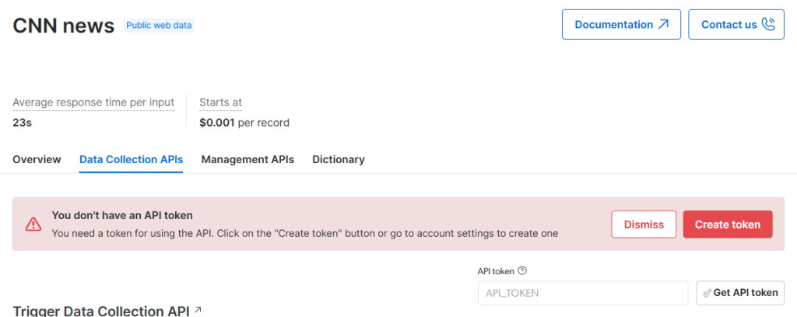
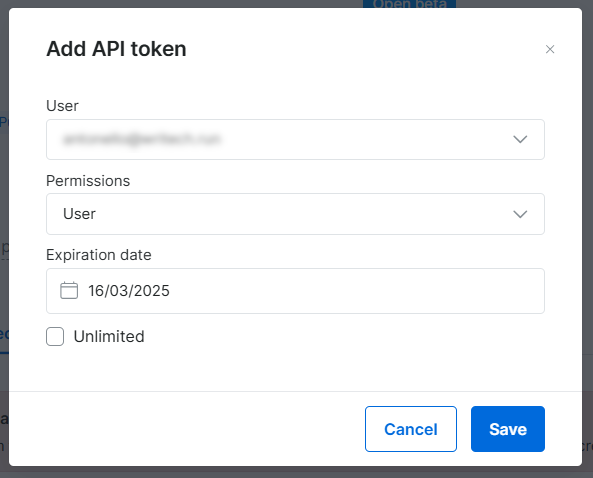
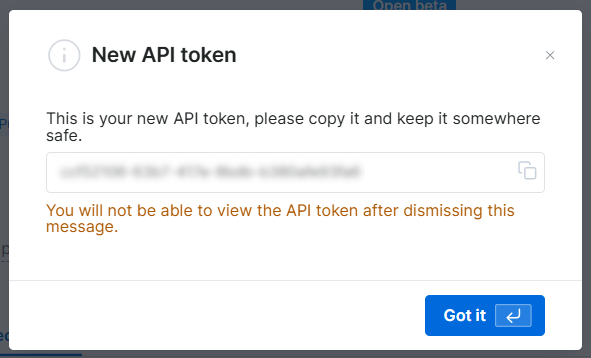
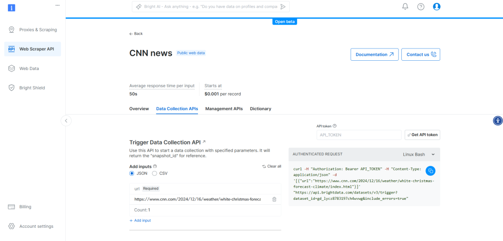
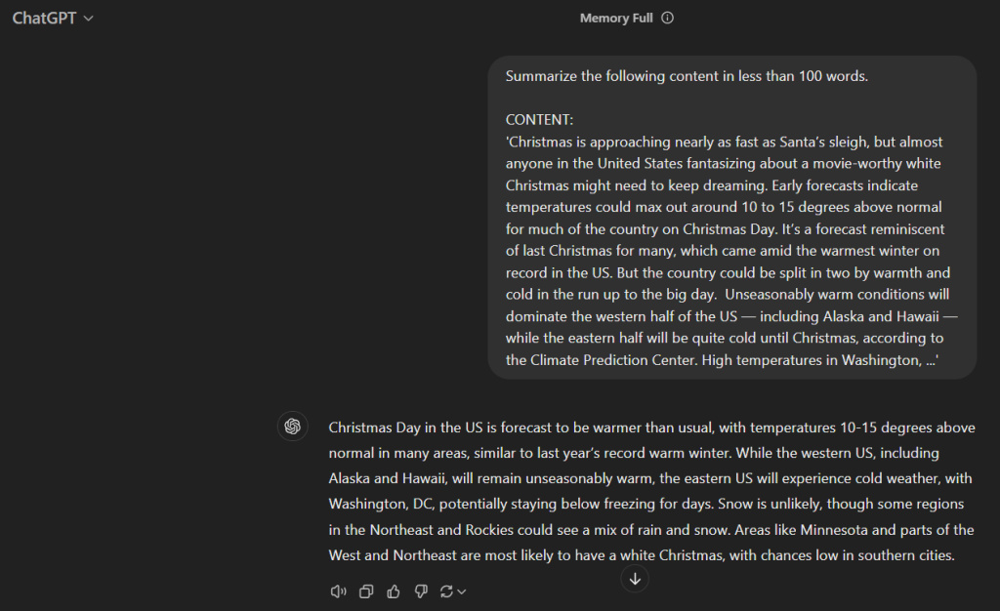

# 使用 LangChain 和 Bright Data 进行网页爬虫

[](https://www.bright.cn/) 

本指南将详细分步介绍如何结合网页爬虫与 LangChain，为实际应用中的 LLM 提供数据增强。

- [使用网页爬虫为你的 LLM 应用提供支持](#使用网页爬虫为你的-llm-应用提供支持)
- [在 LangChain 中使用抓取数据的优势与挑战](#在-langchain-中使用抓取数据的优势与挑战)
- [由 Bright Data 提供支持的 LangChain 网页爬虫：分步指南](#由-bright-data-提供支持的-langchain-网页爬虫分步指南)
  - [前提条件](#前提条件)
  - [第 1 步：项目设置](#第-1-步项目设置)
  - [第 2 步：安装所需库](#第-2-步安装所需库)
  - [第 3 步：准备项目](#第-3-步准备项目)
  - [第 4 步：配置网页爬虫工具 API](#第-4-步配置网页爬虫工具-api)
  - [第 5 步：使用 Bright Data 进行网页爬虫](#第-5-步使用-bright-data-进行网页爬虫)
  - [第 6 步：准备使用 OpenAI 模型](#第-6-步准备使用-openai-模型)
  - [第 7 步：生成 LLM 提示词](#第-7-步生成-llm-提示词)
  - [第 8 步：集成 OpenAI](#第-8-步集成-openai)
  - [第 9 步：导出经 AI 处理的数据](#第-9-步导出经-ai-处理的数据)
  - [第 10 步：添加日志](#第-10-步添加日志)
  - [第 11 步：整合所有代码](#第-11-步整合所有代码)
- [总结](#总结)


## 使用网页爬虫为你的 LLM 应用提供支持

网页爬虫从网站提取数据，为 RAG（[检索增强生成](https://www.bright.cn/blog/web-data/rag-explained)）应用提供支持并充分利用 LLM（[大语言模型](https://www.ibm.com/think/topics/large-language-models)）。它弥合了静态数据库与这些应用所需的实时数据、特定领域数据或大型数据集之间的差距。

## 在 LangChain 中使用抓取数据的优势与挑战

[LangChain](https://www.langchain.com/) 将 LLM 与各种数据源集成，用于分析、总结和问答等任务。然而，由于反机器人措施、CAPTCHA 和动态网站的存在，获取高质量数据并不容易。Bright Data 的[网页爬虫工具 API](https://www.bright.cn/products/web-scraper)通过 IP 轮换、验证码破解和 JavaScript 渲染等功能解决了这些问题，只需简单的 API 调用即可实现高效、可靠的数据采集。

## 由 Bright Data 提供支持的 LangChain 网页爬虫：分步指南

学习构建一个 LangChain 网页爬虫脚本，使用 Bright Data 的网页爬虫工具 API 获取 CNN 文章内容，然后将其发送到 OpenAI 进行总结。我们将以[这篇 CNN 文章](https://www.cnn.com/2024/12/16/weather/white-christmas-forecast-climate/)为目标。


这个简单示例可以轻松扩展，加入更多 LangChain 功能，例如基于 SERP 数据创建 AG 聊天机器人。

### 前提条件

要完成本指南，你需要准备以下内容：

- 你的计算机上已安装 Python 3+
- OpenAI API 密钥
- Bright Data 账户

### 第 1 步：项目设置

确保已安装 Python 3。然后为项目创建一个文件夹：

```bash
mkdir langchain_scraping
```

`langchain_scrping` 将包含你的 Python LangChain 抓取项目。

然后进入项目文件夹，并在其中初始化 Python 虚拟环境：

```bash
cd langchain_scraping
python3 -m venv env
```

> **注意**：
>
> 在 Windows 上，请使用 `python` 而不是 `python3`。

现在，在你常用的 Python IDE 中打开项目目录，并在 `langchain_scraping` 中添加一个 `script.py` 文件。

激活虚拟环境：

```bash
./env/bin/activate
```

或者，在 Windows 上运行：

```bash
env/Scripts/activate
```

### 第 2 步：安装所需库

这个 Python LangChain 爬虫项目依赖以下库：

- [`python-dotenv`](https://pypi.org/project/python-dotenv/)：用于从 `.env` 文件加载环境变量。它将用于管理 Bright Data 和 OpenAI 凭据等敏感信息。
- [`requests`](https://pypi.org/project/requests/)：用于执行 HTTP 请求，以便与 Bright Data 的网页爬虫工具 API 交互。
- [`langchain_openai`](https://pypi.org/project/langchain-openai/)：通过其 [`openai`](https://pypi.org/project/openai/) SDK 为 OpenAI 提供 LangChain 集成。

在已激活的虚拟环境中安装所有依赖项：

```bash
pip install python-dotenv requests langchain-community
```

### 第 3 步：准备项目

在 `scripts.py` 中添加以下导入：

```python
from dotenv import load_dotenv
import os
```

这两行代码允许你读取环境变量文件。

在项目文件夹中创建一个 `.env` 文件，用于存储所有凭据。

在 `script.py` 中指示 `python-dotenv` 从 `.env` 加载环境变量：

```python
load_dotenv()
```

现在，你可以通过以下方式从 `.env` 文件或系统中读取环境变量：

```python
os.environ.get("<ENV_NAME>")
```

### 第 4 步：配置网页爬虫工具 API

Bright Data 的网页爬虫工具 API 让你可以轻松获取 100 多个网站的解析内容。

要设置网页爬虫工具 API，请参阅[官方文档](https://docs.brightdata.com/scraping-automation/web-data-apis/web-scraper-api/overview)，或按照以下说明操作。

如果你还没有 Bright Data 账户，请先创建一个。登录后，进入账户控制面板，然后点击左侧的“网页爬虫工具 API”按钮：



由于目标网站是 [CNN.com](http://cnn.com/)，请在搜索框中输入“cnn”，然后选择“CNN 新闻：按 URL 收集”爬虫工具：



在当前页面上，点击 **创建令牌** 按钮以生成 [Bright Data API 令牌](https://docs.brightdata.com/general/account/api-token)：



这将打开以下模态窗口，你可以在其中配置令牌的详细信息：



完成后，点击**保存**并复制你的 Bright Data API 令牌值。



在你的 `.env` 文件中，按以下方式存储此信息：

```python
BRIGHT_DATA_API_TOKEN="<YOUR_BRIGHT_DATA_API_TOKEN>"
```

将 `<YOUR_BRIGHT_DATA_API_TOKEN>` 替换为你从模态窗口中复制的值。

你的 CNN 新闻网页爬虫工具 API 页面现在应该与以下示例类似：



### 第 5 步：使用 Bright Data 进行网页爬虫

网页爬虫工具 API 会启动一个根据你的需求定制的任务，然后生成抓取数据的快照。流程概述如下：

1. **提交请求：** 提供需要抓取的页面 URL。
2. **启动任务：** API 从给定的 URL 获取并解析数据。
3. **获取快照：** 持续查询快照 API，在任务完成后获取结果。

CNN 网页爬虫工具 API 的 POST 端点为：

```
"https://api.brightdata.com/datasets/v3/trigger?dataset_id=gd_lycz8783197ch4wvwg&include_errors=true"
```

该端点接受一个包含 `url` 字段的对象数组，并返回如下响应：

```json
{"snapshot_id":"<YOUR_SNAPSHOT_ID>"}
```

然后，你需要使用此响应中的 `snapshot_id` 查询以下端点来获取数据：

```
https://api.brightdata.com/datasets/v3/snapshot/<YOUR_SNAPSHOT_ID>?format=json
```

如果任务仍在进行，该端点将返回 HTTP 状态码 [`202`](https://developer.mozilla.org/en-US/docs/Web/HTTP/Status/202)；当任务完成且数据准备就绪时，则返回 [`200`](https://developer.mozilla.org/en-US/docs/Web/HTTP/Status/200)。建议每隔 10 秒轮询一次该端点，直到任务完成。

任务完成后，该端点将返回以下格式的数据：

```json
[
    {
        "input": {
            "url": "https://www.cnn.com/2024/12/16/weather/white-christmas-forecast-climate/",
            "keyword": ""
        },
        "id": "https://www.cnn.com/2024/12/16/weather/white-christmas-forecast-climate/index.html",
        "url": "https://www.cnn.com/2024/12/16/weather/white-christmas-forecast-climate/index.html",
        "author": "Mary Gilbert",
        "headline": "White Christmas forecast: Will you be left dreaming of snow or reveling in it?",
        "topics": [
            "weather"
        ],
        "publication_date": "2024-12-16T13:20:52.800Z",
        "updated_last": "2024-12-16T13:20:52.800Z",
        "content": "Christmas is approaching nearly as fast as Santa’s sleigh, but almost anyone in the United States fantasizing about a movie-worthy white Christmas might need to keep dreaming. Early forecasts indicate temperatures could max out around 10 to 15 degrees above normal for much of the country on Christmas Day. [omitted for brevity...]",
        "videos": null,
        "images": [
                "omitted for brevity..."
        ],
        "related_articles": [],
        "keyword": null,
        "timestamp": "2024-12-16T14:18:14.101Z"
    }
]
```

`content` 属性包含解析后的文章数据，也就是你希望访问的信息。

要实现此功能，首先从 `.env` 读取环境变量并初始化端点 URL 常量：

```
BRIGHT_DATA_API_TOKEN = os.environ.get("BRIGHT_DATA_API_TOKEN")
BRIGHT_DATA_CNN_WEB_SCRAPER_API_URL = "https://api.brightdata.com/datasets/v3/trigger?dataset_id=gd_lycz8783197ch4wvwg&include_errors=true"
```

现在，将上述流程封装为一个可复用函数：

```python
def get_scraped_data(url):
    # Authorization headers
    headers = {
    "Authorization": f"Bearer {BRIGHT_DATA_API_TOKEN}"
    }
    # Web Scraper API payload
    data = [{
        "url": url
    }]

    # Making the POST request to the Bright Data Web Scraper API
    response = requests.post(BRIGHT_DATA_CNN_WEB_SCRAPER_API_URL, headers=headers, json=data)

    if response.status_code == 200:
        response_data = response.json()
        snapshot_id = response_data.get("snapshot_id")
        if snapshot_id:
            # Iterate until the snapshot is ready
            snapshot_url = f"https://api.brightdata.com/datasets/v3/snapshot/{snapshot_id}?format=json"

            while True:
                snapshot_response = requests.get(snapshot_url, headers=headers)

                if snapshot_response.status_code == 200:
                    # Parse and return the snapshot data
                    snapshot_response_data = snapshot_response.json()
                    return snapshot_response_data[0].get("content")
                elif snapshot_response.status_code == 202:
                    print("Snapshot not ready yet. Retrying in 10 seconds...")
                    time.sleep(10)  # Wait for 10 seconds before retrying
                else:
                    print(f"Failed to retrieve snapshot. Status code: {snapshot_response.status_code}")
                    print(snapshot_response.text)
                    break
        else:
            print("Snapshot ID not found in the response")
    else:
        print(f"Error: {response.status_code}")
        print(response.text)
```

添加以下两个导入以使其正常运行：

```python
import requests
import time
```

### 第 6 步：准备使用 OpenAI 模型

本示例使用 OpenAI 模型在 LangChain 中进行 LLM 集成。请在环境变量中配置 OpenAI API 密钥以使用这些模型。

默认情况下，`langchain_openai` 会自动从 [`OPENAI_API_KEY`](https://python.langchain.com/docs/integrations/llms/openai/#credentials) 环境变量中读取 OpenAI API 密钥。要完成设置，请将以下行添加到你的 `.env` 文件中：

```
OPENAI_API_KEY="<YOUR_OPEN_API_KEY>"
```

将 `<YOUR_OPENAI_API_KEY>` 替换为你的 [OpenAI API 密钥](https://platform.openai.com/api-keys)。如果你不知道如何获取密钥，请参阅[官方指南](https://platform.openai.com/docs/quickstart)。

### 第 7 步：生成 LLM 提示词

定义一个函数，接收抓取的数据并生成用于总结文章的提示词：

```python
def create_summary_prompt(content, words=100):
    return f"""Summarize the following content in less than {words} words.

           CONTENT:
           '{content}'
           """
```

在当前示例中，完整的提示词如下：

```
Summarize the following content in less than 100 words.

CONTENT:
'Christmas is approaching nearly as fast as Santa’s sleigh, but almost anyone in the United States fantasizing about a movie-worthy white Christmas might need to keep dreaming. Early forecasts indicate temperatures could max out around 10 to 15 degrees above normal for much of the country on Christmas Day. It’s a forecast reminiscent of last Christmas for many, which came amid the warmest winter on record in the US. But the country could be split in two by warmth and cold in the run up to the big day. [omitted for brevity...]'
```

将其传递给 ChatGPT 后，你将看到以下内容：



### 第 8 步：集成 OpenAI

首先，调用 `get_scraped_data()` 函数从文章页面获取内容：

```python
article_url = "https://www.cnn.com/2024/12/16/weather/white-christmas-forecast-climate/"
scraped_data = get_scraped_data(article_url)
```

如果 `scraped_data` 不是 `None`，则生成提示词：

```python
if scraped_data is not None:
    prompt = create_summary_prompt(scraped_data)
```

最后，将其传递给一个基于 [GPT-4o mini](https://openai.com/index/gpt-4o-mini-advancing-cost-efficient-intelligence/) AI 模型配置的 [`ChatOpenAI`](https://python.langchain.com/docs/integrations/chat/openai/) LangChain 对象：

```python
model = ChatOpenAI(model="gpt-4o-mini")
response = model.invoke(prompt)
```

从 `langchain_openai` 导入 `ChatOpenAI`：

```python
from langchain_openai import ChatOpenAI
```

流程结束时，`summary` 应包含与上一步中 ChatGPT 生成的摘要类似的内容：

```python
summary = response.content
```

### 第 9 步：导出经 AI 处理的数据

现在，你需要将所选 AI 模型通过 LangChain 生成的数据导出为便于阅读的格式，例如 JSON 文件。

为此，请使用所需数据初始化一个字典，然后将其导出并保存为 JSON 文件，如下所示：

```python
export_data = {
    "url": article_url,
    "summary": summary
}

file_name = "summary.json"
with open(file_name, "w") as file:
    json.dump(export_data, file, indent=4)
```

从 Python 标准库中导入 [`json`](https://docs.python.org/3/library/json.html)：

```python
import json
```

### 第 10 步：添加日志

使用网页爬虫 AI 进行抓取并通过 ChatGPT 分析可能需要一些时间。要跟踪脚本进度，请在脚本的关键步骤添加 `print()` 语句来记录日志：

```python
article_url = "https://www.cnn.com/2024/12/16/weather/white-christmas-forecast-climate/"
print(f"Scraping data from '{article_url}'...")
scraped_data = get_scraped_data(article_url)

if scraped_data is not None:
    print("Data successfully scraped, creating summary prompt")
    prompt = create_summary_prompt(scraped_data)

    # Ask ChatGPT to perform the task specified in the prompt
    print("Sending prompt to ChatGPT for summarization")
    model = ChatOpenAI(model="gpt-4o-mini")
    response = model.invoke(prompt)

    # Get the AI result
    summary = response.content
    print("Received summary from ChatGPT")

    # Export the produced data to JSON
    export_data = {
        "url": article_url,
        "summary": summary
    }

    print("Exporting data to JSON")
    # Write the output dictionary to JSON file
    file_name = "summary.json"
    with open(file_name, "w") as file:
        json.dump(export_data, file, indent=4)
    print(f"Data exported to '${file_name}'")
else:
    print("Scraping failed")
```

### 第 11 步：整合所有代码

最终的 `script.py` 文件应包含以下内容：

```python
from dotenv import load_dotenv
import os
import requests
import time
from langchain_openai import ChatOpenAI
import json

load_dotenv()

BRIGHT_DATA_API_TOKEN = os.environ.get("BRIGHT_DATA_API_TOKEN")
BRIGHT_DATA_CNN_WEB_SCRAPER_API_URL = "https://api.brightdata.com/datasets/v3/trigger?dataset_id=gd_lycz8783197ch4wvwg&include_errors=true"

def get_scraped_data(url):
    # Authorization headers
    headers = {
        "Authorization": f"Bearer {BRIGHT_DATA_API_TOKEN}"
    }

    # Web Scraper API payload
    data = [{
        "url": url
    }]

    # Making the POST request to the Bright Data Web Scraper API
    response = requests.post(BRIGHT_DATA_CNN_WEB_SCRAPER_API_URL, headers=headers, json=data)

    if response.status_code == 200:
        response_data = response.json()
        snapshot_id = response_data.get("snapshot_id")
        if snapshot_id:
            # Iterate until the snapshot is ready
            snapshot_url = f"https://api.brightdata.com/datasets/v3/snapshot/{snapshot_id}?format=json"

            while True:
                snapshot_response = requests.get(snapshot_url, headers=headers)

                if snapshot_response.status_code == 200:
                    # Parse and return the snapshot data
                    snapshot_response_data = snapshot_response.json()
                    return snapshot_response_data[0].get("content")
                elif snapshot_response.status_code == 202:
                    print("Snapshot not ready yet. Retrying in 10 seconds...")
                    time.sleep(10)  # Wait for 10 seconds before retrying
                else:
                    print(f"Failed to retrieve snapshot. Status code: {snapshot_response.status_code}")
                    print(snapshot_response.text)
                    break
        else:
            print("Snapshot ID not found in the response")
    else:
        print(f"Error: {response.status_code}")
        print(response.text)


def create_summary_prompt(content, words=100):
    return f"""Summarize the following content in less than {words} words.

           CONTENT:
           '{content}'
           """

# Retrieve the content from the given web page
article_url = "https://www.cnn.com/2024/12/16/weather/white-christmas-forecast-climate/"
scraped_data = get_scraped_data(article_url)

# Ask ChatGPT to perform the task specified in the prompt
prompt = create_summary_prompt(scraped_data)
model = ChatOpenAI(model="gpt-4o-mini")
response = model.invoke(prompt)

# Get the AI result
summary = response.content

# Export the produced data to JSON
export_data = {
    "url": article_url,
    "summary": summary
}

# Write dictionary to JSON file
with open("summary.json", "w") as file:
    json.dump(export_data, file, indent=4)
```

使用以下命令验证它是否正常运行：

```bash
python3 script.py
```

或者，在 Windows 上运行：

```powershell
python script.py
```

终端中的输出应与以下内容类似：

```
Scraping data from 'https://www.cnn.com/2024/12/16/weather/white-christmas-forecast-climate/'...
Snapshot not ready yet. Retrying in 10 seconds...
Data successfully scraped, creating summary prompt
Sending prompt to ChatGPT for summarization
Received summary from ChatGPT
Exporting data to JSON
Data exported to 'summary.json'
```

打开项目目录中生成的 `open.json` 文件，你应该会看到类似以下的内容：

```json
{
    "url": "https://www.cnn.com/2024/12/16/weather/white-christmas-forecast-climate/",
    "summary": "As Christmas approaches, forecasts indicate temperatures in the US may be 10 to 15 degrees above normal, continuing a trend from last year\u2019s warm winter. The western US will likely remain warm, while the East experiences colder conditions leading up to Christmas. Some areas may see a mix of rain and snow, but a true \"white Christmas\" requires at least an inch of snow on the ground. Historically, cities like Minneapolis and Burlington have the best chances for snow, while places like New York City and Atlanta have significantly lower probabilities."
}
```

## 总结

这种方法面临多项挑战：

- **结构变化：** 网站经常更新其页面布局。
- **反机器人措施：** 高级防御机制十分常见。
- **可扩展性：** 提取大量数据可能既复杂又昂贵。

Bright Data 的网页爬虫工具 API 能够克服这些障碍，是 RAG 和 LangChain 驱动型解决方案中非常有价值的工具。

立即注册并探索我们为 [AI 和 LLM 提供的更多产品](https://www.bright.cn/ai)！
